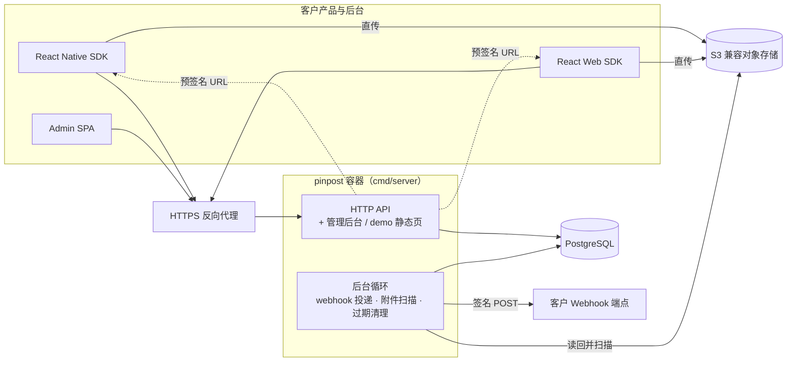

# Pinpost 跨平台反馈系统设计

> 状态：Phase 1 已实现，本文于 2026-11 与代码对齐（持久化已从 DynamoDB 迁到 PostgreSQL）  
> 目标平台：iOS、Android、Web；优先提供 React Native / React SDK  
> 后端：单个 Go 进程 + PostgreSQL + S3 兼容对象存储，`docker compose up` 自部署  
> 本文边界：定义产品、架构、接口、数据、安全、运维与交付方案，不包含业务实现代码。
> 实现细节、本地启动方式和当前已知边界见 [README](../README.md)；两者冲突时以代码为准

## 1. 背景与目标

Pinpost 是一个可嵌入客户产品的反馈系统。最终用户无需离开当前页面或 App，即可提交问题、建议、表扬或其他反馈；客户团队在统一后台中查看、分类、回复、指派和跟踪这些反馈。

### 1.1 核心目标

1. 同一套产品能力覆盖 iOS、Android 和 Web。
2. 集成成本低：React Native / React 项目在较短时间内可以显示反馈入口。
3. 可靠接收文本、评分、上下文、截图和附件，弱网环境下不轻易丢失。
4. 从第一天支持多租户，确保不同客户的数据严格隔离。
5. 反馈字段、主题和触发方式可配置，但 MVP 不演变成通用表单平台。
6. 后端保持简单，并且能自部署：一个 Go 模块化单体容器、一个 PostgreSQL、一个
   S3 兼容对象存储，`docker compose up` 即可运行，不依赖任何云厂商的专有服务。
7. 默认保护隐私；截图、日志和用户身份必须由客户显式配置。

### 1.2 非目标

- MVP 不替代完整客服工单系统或 CRM。
- MVP 不提供社区论坛、公开 Roadmap 和投票社区。
- MVP 不做实时聊天。
- MVP 不使用 AI 自动做最终决策；后续可做摘要、聚类和建议标签。
- 不承诺 UI 在三个平台像素完全一致；行为和设计令牌一致，交互遵守平台习惯。

## 2. 名词与角色

| 名词 | 含义 |
|---|---|
| Organization | 使用 Pinpost 的客户组织，是最高租户边界 |
| Project | 组织下的一个产品，如 `Acme Mobile` |
| Environment | `development`、`staging`、`production` 等运行环境 |
| End User | 在客户 App / Web 中提交反馈的人，可以匿名 |
| Member | 登录 Pinpost 管理后台处理反馈的客户团队成员 |
| Feedback | 一次正式提交的反馈记录 |
| Attachment | 截图、图片、视频、日志或其他允许的文件 |
| SDK Write Key | 标识 Project 的公开写入键，不视为秘密，权限只允许采集 |
| Installation | 某个设备或浏览器安装实例的匿名标识 |

角色权限建议：

- Owner：组织、账单、成员、项目、数据的全部权限。
- Admin：项目配置、成员和反馈管理，不可转移组织所有权。
- Agent：查看、分类、指派、回复反馈。
- Viewer：只读。

## 3. 产品范围

### 3.1 最小可用版本（MVP）

客户端：

- 浮动按钮、菜单入口或代码触发的反馈面板。
- 反馈类型：Bug、Suggestion、Other；客户可修改显示名称及开关。
- 文本描述、可选邮箱、可选满意度评分。
- 基础图片附件选择、预览和删除。
- 自动附带经过允许的上下文：App 版本、平台、系统版本、语言、屏幕名、网络状态。
- 匿名或已识别用户提交。
- 上传进度、失败重试、提交成功确认。
- 基础主题、深色模式、国际化与无障碍。

管理后台：

- 登录、组织与项目切换。
- 反馈列表、详情、搜索和筛选。
- 状态、优先级、标签、负责人、内部备注。
- 项目 SDK 设置、字段配置、主题和数据保留策略。
- 基础统计：数量趋势、类型分布、状态分布、平均首次处理时间。

平台能力：

- 多租户隔离、固定角色 RBAC、反馈处理时间线。
- 附件对象存储和恶意文件扫描。
- 速率限制、幂等提交、删除/导出用户数据。
- 可观测性、备份和恢复。

### 3.2 后续能力

- 用户可见回复与反馈状态页。
- 邮件通知、通用 Webhook 和第三方消息渠道。
- Jira、Linear、Slack、Teams、Zendesk 等集成。
- 自定义表单字段和条件显示。
- 会话回放、控制台日志和网络请求记录（必须额外授权与脱敏）。
- AI 摘要、相似反馈聚类、敏感信息检测、自动标签。
- Feature Request 合并、投票与公开 Roadmap。
- SSO/SAML、SCIM、数据驻留和企业审计导出。

## 4. 用户流程

### 4.1 最终用户提交

1. 客户 App 初始化 SDK，并传入 Project Write Key、主题和可选用户身份。
2. SDK 拉取已发布的轻量配置并本地缓存。
3. 用户通过浮动按钮、菜单或业务代码打开反馈面板。
4. SDK 根据配置收集允许的上下文；用户填写内容并检查附件。
5. 如果有附件，SDK 申请预签名 URL 并直传对象存储；提交认领附件后，服务端的后台
   worker 在几秒内校验真实类型并扫描，在此之前附件是 `pending`。
6. SDK 调用 `POST /v1/feedback`，携带文本、上下文、幂等键和已上传 attachment IDs。
7. 服务端在一个事务里写入反馈、首条活动、附件认领和 webhook 事件；幂等由
   `UNIQUE (project_id, idempotency_key)` 保证，重复提交直接返回已有反馈。
8. 当前会话失败时 SDK 使用同一个幂等键重试；跨重启离线队列按真实需求后置。

### 4.2 团队处理

1. Member 在 Inbox 查看新反馈。
2. 按项目、时间、类型、状态、标签、负责人、版本等筛选。
3. 打开详情，查看用户填写内容、允许采集的环境信息和附件。
4. 设置负责人、优先级、标签和状态，添加内部备注。
5. 必要时回复最终用户或同步到外部系统。
6. 所有反馈处理动作写入 `feedback_activity`。

### 4.3 数据删除

1. 客户按 `external_user_id` 或 feedback ID 发起查询。
2. 系统验证操作者权限，删除或匿名化该组织下的业务记录，并删除对象存储附件。
3. 不在日志中留下原始敏感数据。
4. 只有数据规模导致请求无法在合理时间完成时，才升级为异步 `privacy_jobs`。

## 5. 总体架构



### 5.1 架构选择

整套系统是一个 Go 模块化单体进程，加 PostgreSQL 和一个 S3 兼容对象存储：

- 一个 Go 代码库，一个入口 `cmd/server`。同一进程既提供 HTTP API 和静态页面
  （管理后台、demo），也运行后台循环：每 2 秒投递到期的 webhook、扫描已认领的
  附件，每 10 分钟清理过期 session、未认领附件和 30 天前的投递记录。
- PostgreSQL 是业务事实来源。迁移文件嵌入在二进制里，启动时按顺序执行，advisory
  lock 保证多副本同时启动也只执行一次。
- 没有附件时，客户端一次请求完成提交；有附件时先取预签名 URL 直传对象存储，再在
  提交反馈时引用 attachment ID。
- 不存在 Redis、独立消息队列或搜索引擎。异步副作用靠「事务内写入、后台轮询」：
  webhook 事件与业务写入在同一个事务落库（§11），附件在被认领时排进扫描队列；
  worker 用 `FOR UPDATE SKIP LOCKED` 认领，所以多副本不需要选主。
- 部署形态是一个容器：`docker compose up` 启动 pinpost、PostgreSQL 与 RustFS；
  生产环境在前面放一个 HTTPS 反向代理（README 的 Self-hosting 一节）。

选择这套形态的理由是自部署：同类产品用 `docker compose up` 加 Postgres 就能跑起来，
而 Lambda + DynamoDB 要求每个自部署者都有 AWS 账号，DynamoDB Local 也不能用于生产。
早期的无服务器实现（Lambda、DynamoDB 单表与 Streams、Terraform）保留在 git tag
`aws-lambda-dynamodb`。

代价写在明处：进程常驻，没有「无流量零成本」；后台工作靠轮询，webhook 最多晚约
2 秒发出；限流按进程计数。这些取舍在 §12 和 §17 有对应的重新评估触发条件。

## 6. 客户端 SDK 设计

### 6.1 包结构

React Native 与 React 面向不同运行时，但共享同一套反馈协议和提交逻辑。建议 TypeScript Monorepo 只保留三个产品包：

```text
packages/
  core/                 # 类型、API client、校验、身份、上下文、幂等与基础重试
  react-native/         # RN Provider、Hook、Sheet/Modal UI、设备能力适配
  react/                # React Web Provider、组件、浏览器能力适配
```

`core` 不依赖 DOM、React 或 React Native。两个平台包各自实现 UI、截图、文件选择、存储和无障碍行为；设计令牌先作为普通 TypeScript 文件共享，不单独发布 package。

普通 React 网站不应为了共享 UI 而依赖 React Native Web。React SDK 使用 DOM 原生能力，React Native SDK 使用原生组件。只有 API 类型、校验、身份、上下文和提交状态可以共享。

如果首批客户只使用其中一个平台，先交付对应平台包；第二个平台开始开发时再把已验证的重复逻辑提取进 `core`，避免提前抽象错误边界。

### 6.2 对外 API 形态

概念接口如下，最终命名以 SDK RFC 为准：

```ts
type PinpostOptions = {
  writeKey: string;
  environment?: "development" | "staging" | "production" | string;
  apiUrl?: string;
  locale?: string;
  theme?: ThemeOverrides;
  privacy?: {
    collectDeviceInfo?: boolean;
    collectScreenName?: boolean;
    allowScreenshot?: boolean;
  };
};

Pinpost.initialize(options);
Pinpost.identify({ externalUserId, email?, name?, traits?, identityToken? });
Pinpost.setContext({ screenName?, release?, tags?, custom? });
Pinpost.open({ type?, metadata? });
Pinpost.submit(payload);              // headless use case
Pinpost.resetUser();                  // logout 时调用
```

React / React Native 提供 `PinpostProvider`、`usePinpost()` 和默认 `FeedbackWidget`。客户可以：

- 直接使用完整默认 UI。
- 使用 Headless API 自己绘制 UI。
- 配置浮动按钮位置，或完全隐藏并自行触发。

### 6.3 SDK 初始化与配置

- Write Key 只标识 Project 和 Environment，不授予读权限。
- 初始化不得阻塞 App 启动或首屏渲染。
- SDK 使用 `ETag` 拉取已发布配置，设置合理 TTL，并保留最近一次成功配置。
- 配置不可用时使用安全默认值；远程配置不能下发可执行代码。
- SDK 版本与 API 使用显式兼容范围；服务端至少兼容最近两个主要版本。
- 支持 kill switch，在严重问题时关闭入口或特定采集能力。

### 6.4 离线和重试

每次提交生成 UUID v7 形式的 `idempotency_key`。MVP 状态机只覆盖当前 App 会话：

```text
editing -> uploading -> submitting -> succeeded
                |            |
                +-- retry ----+
                       |
                     failed
```

- 不自动持久化未提交文本。
- MVP 在当前会话内重试；只有真实客户证明长时间离线提交是高频需求时，才增加跨重启离线队列。
- 指数退避加随机抖动，遵守 `Retry-After`。
- 仅对网络错误、超时、429 和部分 5xx 自动重试；4xx 校验错误直接提示修正。
- 同一幂等键重试必须返回同一反馈结果。

### 6.5 截图与附件

- MVP 在 Web 和 React Native 都先使用平台文件/图片选择能力，并显示预览和删除操作。
- Web 自动页面截图需要独立能力和显式授权，因为跨域资源、Canvas 和敏感 DOM 会带来限制。
- React Native 一键截图需要平台 adapter 捕获当前应用视图；系统级内容不在范围内。
- 一键截图和敏感区域涂抹属于 Phase 2，只有试点客户确认需要时才实现。
- 默认允许 JPEG、PNG、WebP、纯文本日志和受控文档类型；视频后置。
- SDK 在上传前校验数量、声明类型和大小，但服务端必须再次验证真实 MIME 与文件签名。
- EXIF 默认移除；图片可在客户端压缩，但原始数据是否保留由项目策略决定。

### 6.6 隐私上下文

默认允许的低风险字段：

- SDK 版本、应用版本、平台、OS 主版本、locale、时区、屏幕尺寸。
- 页面地址与来源页，但**去掉 query string、fragment 和 userinfo**（scheme、host、path 原样保留，
  这样 `app://`、`capacitor://`、`file://` 这类深链不会被破坏）。重置密码链接、SSO 回调、分享链接
  会把令牌放在 query 或 fragment 里，`user:secret@` 则把凭据放在 userinfo 里。
  **SDK 和服务端 ingest 都要剥**——write key 本身是公开的，所以信任边界在 ingest，不在 SDK。
  控制台只展示 host + path。
- 客户显式设置的 screen name、release、tags 和 custom context。

默认不采集：

- 剪贴板、键盘输入、精确位置、联系人、广告 ID、完整 IP、任意网络请求内容。
- DOM 全文、完整控制台日志、Access Token、Cookie、密码字段。
- **完整 URL / Referrer**（含 query、fragment 与 userinfo）——按键名过滤的黑名单挡不住藏在值里的令牌。

自定义上下文需要：最大深度、键数量、单值长度和总大小限制；SDK 与服务端共同丢弃黑名单键，如 `password`、`authorization`、`cookie`、`token`。

反馈列表只返回渲染一行所需的 `url` 与 `user_agent`；完整 context 只在单条详情里返回，
避免一个项目的大 context 撑爆整个组织的收件箱分页。

### 6.7 UI 与可访问性

- 移动端使用 Bottom Sheet 或全屏 Modal；Web 使用 Dialog / Side Panel。
- 所有元素支持键盘导航、焦点管理、屏幕阅读器标签和最小触控区域。
- 支持浅色/深色、高对比度、动态字体、RTL。
- 文案由 locale 包提供，客户可覆盖；缺失时回退到英文。
- 避免让 SDK UI 覆盖客户的安全提示、付款确认或系统权限弹窗。

### 6.8 管理后台 Web

管理后台和嵌入式 SDK 是两个独立发布物，不共享认证上下文或可部署 bundle。建议使用 React + TypeScript，并保持以下边界：

- API 数据通过生成自 OpenAPI 的 typed client 访问，页面组件不直接拼接 URL。
- 当前 Organization / Project 是路由和查询缓存键的一部分；切换租户时清空不兼容缓存。
- Inbox 使用服务端 cursor pagination、筛选和排序；不要把全部反馈下载到浏览器再处理。
- 列表到详情的返回保留筛选条件和 cursor，减少团队处理大量反馈时的操作成本。
- 使用 optimistic update 改善标签、负责人等轻量操作，但遇到 `409` 必须回滚并显示最新状态。
- 反馈正文始终以纯文本渲染；附件只能从短期授权 URL 加载。
- 权限判断以服务端为准。前端 capability 只用于改善交互，不能作为安全控制。
- 错误页展示 `request_id` 便于支持排障，但不得显示后端堆栈或敏感上下文。
- 管理后台自身也需覆盖键盘操作、屏幕阅读器、响应式布局和时区显示规则。

## 7. Go 后端设计

### 7.1 模块边界

```text
cmd/
  server/          # 唯一入口：迁移、seed、路由装配、静态文件、后台循环
internal/
  api/             # 由 openapi.yaml 生成的路由与模型 + ServerInterface 实现
  auth/            # Member Session、固定角色、SDK Write Key
  project/         # Organization、Project、Member
  feedback/        # 创建、查询、状态、指派、活动记录
  attachment/      # 上传授权、元数据、扫描状态
  outbox/          # webhook 端点、事务内写入的事件、投递 worker
  platform/        # 共享内核：数据库连接与迁移、对象存储客户端、错误信封、限流、CORS
```

每个功能包自己拥有 HTTP handler、业务规则和数据访问；`cmd/server` 只负责把切片
装配起来。后台循环和 HTTP handler 在同一进程，用的是同一套表结构和查询，不存在
第二份 schema。

同一进程内直接调用模块，不建立内部事件总线、repository interface 或只有一个实现
的抽象层。需要替换的外部边界，例如对象存储和身份提供商，可以有小型 adapter。

### 7.2 API 风格

- 外部 API 采用 JSON over HTTPS，版本前缀 `/v1`。
- SDK Ingestion API 与 Dashboard API 使用不同路由组、中间件和限流策略。
- 时间为 RFC 3339 UTC；ID 对外使用不连续、不可枚举的 UUID v7。
- 列表使用 cursor pagination，不使用深 offset。
- 所有写请求支持或要求 `Idempotency-Key`。
- 错误使用稳定机器码，展示文案由客户端本地化。
- 最大 JSON body 建议 256 KiB；文件不经过 JSON API。

统一错误格式：

```json
{
  "error": {
    "code": "validation_failed",
    "message": "The request is invalid",
    "request_id": "req_...",
    "fields": {
      "message": "required"
    }
  }
}
```

### 7.3 主要 Ingestion API

| Method | Path | 用途 |
|---|---|---|
| `GET` | `/v1/sdk/config` | 按 Write Key 读取已发布 SDK 配置 |
| `POST` | `/v1/attachment-uploads` | 有附件时申请预签名上传 URL |
| `POST` | `/v1/feedback` | 提交反馈以及已上传的 attachment IDs |

无附件反馈只调用 `POST /v1/feedback`。有附件时先申请上传地址并直传对象存储，最后在同一个反馈请求中引用 attachment IDs。MVP 不创建服务器草稿，也不维护草稿状态机。

提交反馈示例：

```json
{
  "type": "bug",
  "message": "Checkout button does not respond",
  "rating": 2,
  "contact": { "email": "user@example.com" },
  "context": {
    "platform": "ios",
    "os_version": "major-only-or-policy-defined",
    "app_version": "4.2.1",
    "sdk_version": "1.0.0",
    "locale": "zh-CN",
    "screen_name": "checkout",
    "custom": { "plan": "pro" }
  }
}
```

服务端响应只返回提交结果，不返回租户内部信息：

```json
{
  "feedback_id": "fb_...",
  "created_at": "2026-08-10T10:00:00Z"
}
```

### 7.4 Dashboard API

后台路由按资源分组如下，完整列表以 `api/openapi.yaml` 为准：

- 登录与会话（无需会话）：`GET /v1/auth/config`、`POST /v1/auth/login`、`POST /v1/auth/google`、`POST /v1/auth/logout`
- 当前用户与初始化：`GET /v1/me`、`GET /v1/setup`
- 组织与项目：`PATCH /v1/organization`、`GET /v1/projects`、`POST /v1/projects`、`PATCH /v1/projects/{id}`、`POST /v1/projects/{id}/write-key/rotate`
- 反馈：`GET /v1/feedback`、`GET /v1/feedback/{id}`、`PATCH /v1/feedback/{id}`（状态、优先级、负责人、标签）、`POST /v1/feedback/{id}/notes`、`GET /v1/feedback/{id}/activities`、`GET /v1/attachments/{id}/download`
- 内部反馈：`POST /v1/internal-feedback`
- 成员与分析：`GET /v1/members`、`GET /v1/analytics/overview`
- Webhook：`GET /v1/webhook-endpoints`、`POST /v1/webhook-endpoints`、`PATCH /v1/webhook-endpoints/{id}`、`DELETE /v1/webhook-endpoints/{id}`、`GET /v1/webhook-endpoints/{id}/deliveries`、`POST /v1/webhook-deliveries/{id}/replay`

`POST /v1/internal-feedback` 让团队成员直接在后台建反馈——线下收集到的、内部
自查发现的，都走这里。它复用 ingestion 的 `feedback.Create`（同一套校验、同一
条幂等键、同一次事务写入），区别只有三点：认证用 session cookie 而不是 write
key、项目由 body 显式指定并校验归属、以及记录落库时带上 `source: internal`。
`source` 由 handler 依据认证身份决定，绝不从 body 读取，也没有任何更新路径能改
它——它是来源事实，不是可编辑的标签，所以没有做成 tag。只读角色（viewer）会被
`requireWrite` 挡在写入之前。

路由与参数解析由 oapi-codegen 从 `api/openapi.yaml` 生成，handler 实现生成的 `ServerInterface`，所以规格里写了却没实现的操作会编译失败。授权在 handler，业务规则在对应领域 package，SQL 留在该领域自己的数据访问代码里（手写 SQL 加 pgx，不用 ORM）。不为每类实体创建形式化 repository interface。

### 7.5 反馈状态机

```text
open -> in_progress -> resolved
 |          |             |
 +-------- spam           +-- reopen -> open
```

- `open`：新提交或重新打开。
- `in_progress`：正在处理。
- `resolved`：已完成处理，允许重新打开。
- `spam`：垃圾反馈，可由有权限成员恢复。

每次状态变化记录 actor、from、to、reason、timestamp，不能只覆盖当前字段。

### 7.6 并发控制

- 创建反馈在一个事务里写入反馈、首条活动、附件认领和 webhook 事件。幂等由
  `UNIQUE (project_id, idempotency_key)` 加 `INSERT ... ON CONFLICT DO NOTHING`
  实现：重复请求什么也不写，读回已有反馈返回；并发的同 key 请求在唯一索引上等前
  一个提交，然后走同一条路径。去重是永久的，没有过期，也没有清理任务。
- 后台更新用 `UPDATE ... WHERE updated_at = $token` 做乐观并发控制，影响 0 行时
  返回 `409 conflict`，由前端重新加载后确认。`updated_at` 一律由数据库 `now()`
  写入、从库里读回，所以客户端回传的令牌和库里的值精确相等。
- 状态变更、活动记录和 webhook 事件在同一个事务写入，不会出现改了状态却没有时间线
  或事件的记录。

## 8. 数据模型

PostgreSQL。表结构由 `internal/platform/migrations/` 下的迁移文件定义，文件只追加，
已发布的文件不再修改（§14.2）。

### 8.1 表

| 表 | 主键 | 要点 |
|---|---|---|
| `organizations` | `id` | |
| `bootstrap` | `singleton` | 至多一行：部署已 seed，以及 Google 首次登录加入哪个组织 |
| `projects` | `id` | `write_key` 唯一（公开标识，明文存储，§9.1）；`settings` 为 jsonb |
| `members` | `id` | `UNIQUE (organization_id, email)`；按 `email` 建索引供登录 |
| `sessions` | `token_hash` | 只存 token 的摘要；带 `expires_at` |
| `feedback` | `id` | `UNIQUE (project_id, idempotency_key)`；`context` 为 jsonb，`tags` 为 text[] |
| `activities` | `id` | 反馈时间线，按 `id` 排序 |
| `attachments` | `id` | `feedback_id` 在认领前为空；`next_scan_at` 是扫描队列 |
| `webhook_endpoints` | `id` | |
| `webhook_deliveries` | `id` | `pending` 的行就是 outbox（§11）；`UNIQUE (endpoint_id, event_id)` |

反馈正文、上下文、tags 和 contact 都在 `feedback` 行里；附件只存元数据，二进制在
对象存储。

ID 是 UUIDv7，在 Go 里生成，字节序就是时间序，所以「按时间倒序 + 游标」就是
`ORDER BY id DESC` 加 `id < $cursor`；游标是编码后的 id，不存在深 offset。

`feedback.source` 记录这条反馈是谁提的：`widget` 是公开 ingestion 收到的用户反馈，
`internal` 是成员在后台自己建的。列是 `NOT NULL DEFAULT 'widget'`。

### 8.2 多租户隔离

- 读：每条组织级查询都带 `organization_id = $n`，值只来自认证上下文（session 或
  write key），绝不由客户端决定；越界读一律返回 404。不按组织过滤的查询只有几类，
  都发生在确立租户之前或与租户无关：write key 认证、session 查找、登录时按邮箱查
  成员、后台 worker 认领、过期清理和 seed。
- 写：复合外键让跨组织的引用在数据库里写不进去——`feedback` 的
  `(organization_id, project_id)` 和 `(organization_id, assignee_id)`，以及
  `attachments` 的 `(project_id, feedback_id) → feedback (project_id, id)`（附件只能
  挂到同一项目的反馈上，不管是哪段代码在写）。
- 不使用 RLS：它要求每个请求都包事务并 `SET LOCAL`，上面那几类合法的跨租户查询
  都得绕过策略，自部署者还要配置多个数据库角色。读路径的护栏是跨租户负向测试
  （§15.2）；企业客户要求库层隔离时再评估。

### 8.3 索引与过期

| 用途 | 索引 |
|---|---|
| Inbox 列表与筛选 | `feedback (organization_id, id)` |
| 登录按邮箱查成员 | `members (email)` |
| 反馈的附件 | `attachments (feedback_id)` |
| 扫描队列 | `attachments (next_scan_at) WHERE scan_status = 'pending' AND feedback_id IS NOT NULL` |
| 投递历史 | `webhook_deliveries (endpoint_id, created_at DESC)` |
| 投递队列 | `webhook_deliveries (next_attempt_at) WHERE status = 'pending'` |

没有 TTL：后台循环每 10 分钟删除过期 session、超过 24 小时仍未认领的附件行和 30 天
前的投递记录，读取 session 时本身也过滤过期行。幂等键随反馈永久保存，不需要清理。

### 8.4 刻意的读放大

- 按 status / type / source / assignee 筛选和 `q` 搜索（`ILIKE`，`%` 和 `_` 按字面
  匹配）都在 `(organization_id, id)` 索引的范围内过滤。
- Overview 是两条 `GROUP BY`，不缓存。

代价的上界是单个租户的数据量，而不是整个库，所以对早期规模是划算的。单个组织的
反馈量超过约 5 万条、或筛选延迟不达标时，加 `(organization_id, status, id)` 这类
复合索引；`q` 搜索延迟不达标时先加 `pg_trgm` 索引，再评估独立搜索。

### 8.5 演进触发条件

| 变更 | 只在何时做 |
|---|---|
| 复合筛选索引 | 单组织反馈量超过约 5 万条，或筛选延迟不达标 |
| `pg_trgm` / 独立搜索服务 | `q` 搜索延迟不达标 |
| End user / Installation 表 | 需要用户画像、跨反馈历史、设备级频控或推送 |
| SDK config 版本表 | 客户需要配置审批、回滚和发布历史 |
| 独立 tag 表 | 标签需要颜色、治理、权限或跨反馈统计 |
| 组织级 audit 表 | 企业客户要求不可变审计 |
| 异步隐私任务表 | 数据规模大到导出或删除不能在一次请求内完成 |

这些都不是提前创建的占位符；需要时加一个迁移文件。

### 8.6 数据完整性

- 外键、唯一约束和 CHECK（类型、状态、优先级、评分 1–5、来源、角色、扫描状态）由
  数据库强制；状态机的转换规则、附件大小与类型在 handler 层校验，并由契约测试覆盖。
- 关键写路径（创建反馈、更新状态、seed 首个租户）在一个事务里完成，不会留下半截
  状态。
- 业务删除优先使用明确状态；个人数据删除必须真的删除或不可逆匿名化，不能只
  soft delete。

## 9. 身份、认证与授权

### 9.1 SDK 请求

- Write Key 是公开标识，不是秘密，不能用它查询反馈或管理项目。因此明文存储（`projects.write_key` 唯一，认证就是一次索引查找），后台「嵌入与集成」可随时查看；所有者/管理员可轮换，轮换是一条 UPDATE，新 key 生效的同时旧 key 失效（无宽限期）。
- 对 Write Key 设置环境状态、Origin/App Identifier allowlist、速率和配额。
- Web 校验 `Origin` 只能降低滥用，不能作为强认证；原生 App Bundle ID 也可被伪造。
- 未登录用户分配随机 installation ID，不使用硬件指纹。
- 已登录用户由客户服务器签发短期 `identityToken`，内容至少含 organization/project、external user ID、过期时间和 nonce；Pinpost 校验签名后标记为 verified。
- 不应要求客户把签名密钥放入 App 或浏览器。

### 9.2 Dashboard

当前实现是自持的密码会话，而不是外部 OIDC：托管身份服务在这个规模上是一笔固定
月费，而后台用户是客户团队成员，不是终端用户。

- 密码用 bcrypt 存储。登录时按邮箱查 `members`，未命中也照样对一个固定 hash 跑一次
  bcrypt，否则响应时间就是一个账号枚举接口。
- Session 是 `sessions` 表的一行，只存 token 的 SHA-256 摘要；读取时过滤过期行，
  后台定期清理。Cookie 为 HttpOnly、`SameSite=Lax`、`Path=/`。
- `Secure` 标志按请求判定：TLS 由部署前面的反向代理终止，转发到本服务的是明文
  HTTP，所以 `r.TLS` 为 nil，判据是代理设置的 `X-Forwarded-Proto`；本地 http 开发没有这个头，于是不加标志。清除 Cookie 时
  必须重复同一组属性，否则浏览器会把原来那个留着。
- 没有独立的 CSRF token，防护来自 `SameSite=Lax` 加上写操作均非简单请求。引入
  跨站嵌入的后台组件之前需要重新评估。
- 服务端对每个资源执行组织作用域 + capability 检查（§8.2），不依赖前端隐藏按钮。
- 企业阶段再增加 OIDC/SAML SSO、SCIM 和可配置 Session 策略；届时上面这套换成
  adapter，而不是并存两套密码系统。

### 9.3 服务与运维访问

- 云工作负载身份访问对象存储和密钥管理，不保存长期云密钥。
- 管理员 impersonation 默认关闭；若启用，必须审批、限时、明确横幅并完整审计。
- 对象存储密钥只授予附件桶的读写；数据库账号只需要应用库的权限（启动时迁移需要
  DDL 权限，需要最小权限账号时再拆出单独的迁移命令）。

## 10. 安全与隐私

### 10.1 威胁重点

| 风险 | 控制 |
|---|---|
| 公开 Write Key 被滥用 | WAF、按 key/IP/installation 限流、配额、行为规则、可轮换 key |
| 跨租户读取 | 每层租户作用域、RBAC、集成测试、可选 RLS、不可枚举 ID |
| 附件恶意内容 | 预签名限制、隔离 bucket/prefix、MIME sniff、病毒扫描、下载时安全响应头 |
| Webhook SSRF | 仅 HTTPS、DNS/IP 解析校验、阻止私网/metadata 地址、固定 egress proxy、重定向限制 |
| PII 泄漏到日志 | 结构化日志 allowlist、字段脱敏、禁止记录 body/token/预签名 URL |
| 用户身份伪造 | 客户服务端签名的短期 identity token |
| 重放与重复提交 | nonce、过期时间、幂等键、请求大小与时间窗限制 |
| XSS/富文本攻击 | 反馈正文按纯文本存储/渲染；Markdown 如启用必须严格 sanitize |

### 10.2 加密与密钥

- 全部公网传输使用 TLS。
- 数据库与对象存储启用静态加密（托管 PostgreSQL 通常默认开启，自部署由磁盘或卷
  加密提供；桶使用 SSE-S3、KMS 或对象存储自带的加密）。
- 邮箱等敏感字段使用 KMS envelope encryption；Webhook 上线后对其 Secret 使用相同策略。
- 搜索用邮箱保存规范化后的 keyed hash；展示值使用加密原文。
- Secret 有版本号和轮换流程，严禁写入 Git、日志或错误追踪 payload。

### 10.3 附件访问

- 对象存储 bucket 不公开。
- 上传 URL 短期有效，只允许指定 object key、大小区间与 content type。
- 上传完成后校验 checksum；未扫描附件不能向后台成员提供内联预览。
- 下载使用短期签名 URL 或鉴权代理，并设置 `Content-Disposition`、`X-Content-Type-Options: nosniff` 和严格 CSP。
- 未关联的临时上传：元数据行 24 小时后由后台清理；对象本身还留在桶里，需要时在
  同一次清理中删除对象，或配置对象存储的生命周期策略。

### 10.4 保留与合规

- 每个组织配置 30/90/365 天或自定义保留期，套餐可限制范围。
- 附件可使用比文本更短的保留期。
- IP 如为安全目的处理，只保留截断值或短期 keyed hash，并明确 TTL。
- 提供用户数据导出、删除、处理记录和数据处理协议所需能力。
- 数据驻留属于部署拓扑能力，不应仅靠表字段假装实现。
- 备份中的已删除数据按备份周期自然过期；恢复后重新应用 deletion tombstone。

## 11. 异步事件、通知与 Webhook

Webhook 已经实现；Email 通知仍是后续能力。这一章描述当前的投递机制。

### 11.1 事件在业务事务里写入（transactional outbox）

业务写路径（创建反馈、更新状态与指派、添加备注）在自己的事务里调用
`outbox.Enqueue`，为每个订阅了该事件、且处于 active 状态的端点插入一行 `pending`
的 `webhook_deliveries`。

- 事件当且仅当它描述的变更提交时存在，回滚的写入不留下事件——这正是 Outbox 模式
  要解决的问题，而 outbox 就是投递表本身，不需要第二张表。
- 事件 ID 在写入时生成并保存在行上，重试和手动重放都沿用它，按
  `X-Pinpost-Event-Id` 去重的消费者只会看到一次。投递语义是至少一次。
- `TestWritesEnqueueTheirEvents` 钉住「哪种写入产生哪种事件、payload 含什么」的
  映射；重复指派同一个人不算变化，不产生事件。
- 端点处于暂停状态时，新发生的事件不会为它入队。

事件命名：

- `feedback.created.v1`
- `feedback.status_changed.v1`
- `feedback.assigned.v1`
- `feedback.note_added.v1`

`feedback.created.v1` 的 payload 带 `source`，消费者据此把内部反馈和客户反馈分
流——同一个 Slack 频道或 issue tracker 通常不希望两者混在一起。

事件 schema 一旦对外必须版本化；内部字段不应直接原样泄露到 Webhook。

### 11.2 Webhook 投递

- Owner/Admin 通过 `POST/GET/PATCH/DELETE /v1/webhook-endpoints` 管理端点，
  secret 只在创建时返回一次。
- 签名：`X-Pinpost-Signature: v1=hex(HMAC-SHA256(secret, "<timestamp>.<body>"))`，
  Header 另含 event ID、delivery ID 和 timestamp。
- 后台循环每 2 秒调用一次 `DispatchDue`：用 `FOR UPDATE SKIP LOCKED` 认领最多 10
  条到期投递，把 `next_attempt_at` 推后 2 分钟作为租约并提交，然后在事务外并发发送，
  最后记录结果。慢订阅者不会占住数据库连接；发送后、记录前崩溃的投递在租约结束后
  重发；多副本不会认领同一行。
- 5xx/408/429/网络错误按 1 分钟、5 分钟、30 分钟、2 小时、6 小时、12 小时重试，共
  7 次、约 20 小时，之后标为 `failed`；其他 4xx 立即失败。待重试的投递在 API 里带
  `next_attempt_at`。
- 每条投递单独记录结果，一个坏订阅者只影响它自己的投递，健康端点不会被重发。
- 连续 10 次失败自动暂停端点。暂停前已入队的投递会保留，`PATCH {"status":"active"}`
  恢复后继续发送；`POST /v1/webhook-deliveries/{id}/replay` 内联重发一次已完成的
  投递且不改变事件 ID。
- 投递记录保存状态、延迟和截断后的 body，30 天后由后台清理，不存潜在 secret。
- 轮询意味着事件最多晚约 2 秒发出。需要更低延迟时，在事务里加 `pg_notify`，让
  worker `LISTEN`。

### 11.3 通知

Email 通知尚未实现。上线时遵循：

## 12. 性能、容量与可靠性

### 12.1 初始容量假设

在缺少真实流量前，使用可调整的保守基线：

- 100 个组织、500 个项目。
- 日均 100,000 条反馈，峰值 50 次提交/秒。
- 20% 反馈带附件，平均附件 1.5 MiB。
- 文本与元数据平均 8 KiB。
- 约 30 GiB/天新增附件，远高于表里的文本数据，因此附件生命周期和成本是首要容量变量；
  数据库存储与日志量是另外两个。

这些数字不是产品承诺。上线前需用真实客户数量、DAU、入口曝光率、提交率和附件率重新计算。

### 12.2 SLO 建议

| 指标 | 初始目标 |
|---|---|
| Ingestion API 可用性 | 月度 99.9% |
| 无附件提交 API p95 | 小于 500 ms（服务端，不含公网） |
| SDK 配置 API p95 | 小于 200 ms，可 CDN 缓存 |
| Dashboard 主要列表 p95 | 小于 1 s |
| 反馈入库到后台可见 | 99% 小于 5 s |
| 已确认提交的数据持久性 | 取决于 PostgreSQL 的部署与备份：托管多可用区数据库加 S3 可做到 99.999999% 级别设计；自部署单机取决于部署方的备份 |

客户端“提交成功”只在写入事务提交后返回。附件是例外，见 §10.3 与 README 的
Boundaries：附件在扫描完成前即可关联到反馈，因为 SDK 可能在上传后几毫秒就提交，
为这个竞态丢掉一条用户反馈比展示一个 `pending` 附件更糟；下载仍然只放行 `clean`。

### 12.3 超时与隔离

- HTTP server 设置 read/header/write/idle timeout。并发由 Go 运行时和数据库连接池
  （pgxpool 默认大小）承载，连接池耗尽表现为请求排队。
- 后台工作不占用请求路径：扫描每批最多 5 个对象（内存上限约 50 MiB），投递在
  事务外发送，单次请求 10 秒超时。
- 外部调用（webhook）只在后台循环里发生，不会拉长用户提交路径。
- 按 project + IP 的分钟级限流计数在进程内存里；多副本时各自计数，有效上限是 N 倍。
  需要全局一致时把计数移到 PostgreSQL。
- 优雅停机：收到 SIGTERM 后先停后台循环，再在 20 秒内处理完进行中的请求。

### 12.4 备份与灾备

- 自部署：定期 `pg_dump`（或文件系统级备份加 WAL 归档），并和附件桶一起备份——
  反馈行按 object key 引用附件。托管 PostgreSQL 使用其自动备份与 PITR。
- 每季度执行一次恢复演练，记录 RTO/RPO，而不只是假设备份可用。
- 初始目标：RPO 取决于备份方式（托管 PITR 约 5 分钟），RTO ≤ 4 小时；企业需求再提升。
- 附件桶启用版本控制与生命周期策略；删除恢复能力与合规删除之间要有明确窗口。
- 跨区域灾备（只读副本或托管的跨区域复制）在单区域运行稳定后再引入。

## 13. 可观测性

### 13.1 统一信号

- Logs：`log/slog` 输出结构化 JSON 到 stdout，由容器平台收集，包含 request ID、
  route、status、latency 和租户的不可逆内部标识；不含请求正文。保留期按平台计费决定。
- Metrics：目前没有导出指标。需要时先直接观察两个队列：`webhook_deliveries` 里
  `status = 'pending' AND next_attempt_at < now()` 的行数（投递积压），以及
  `attachments` 里待扫描的行数。下一步是加 Prometheus `/metrics`。
- Traces：需要时接入 OpenTelemetry；对高流量成功请求采样，对错误提高采样率。
- Audit：反馈处理动作由 `activities` 表记录；组织级审计在企业需求出现后再单列。

### 13.2 核心告警

- Ingestion 5xx 或延迟超过 SLO 窗口。
- `/healthz` 返回 503、数据库连接失败或连接池持续等待。
- 到期未发的 pending 投递持续增加——这是 webhook 投递积压的先行指标。
- 标为 `failed` 的投递突增，或端点被自动暂停。
- 附件上传或对象存储错误率突升；扫描失败日志非零。
- 单租户提交速率、拒绝率或附件流量异常。
- 数据库与对象存储容量增长异常。

告警必须指向 Runbook，明确检查项、止损操作和升级联系人。

## 14. 部署拓扑

### 14.1 环境

- Local：`docker compose up -d --wait postgres s3` 启动 PostgreSQL 与 RustFS，
  `go run ./cmd/server` 直接跑同一个二进制；迁移在启动时执行，桶缺失时自动创建。
- CI：同样两个容器，跑单元测试、契约测试（kin-openapi 校验每个规格操作）和跨租户
  越权测试；设置了 `CI` 时，集成测试连不上依赖会失败而不是跳过。`compose-smoke`
  任务构建镜像、启动完整的三件套、登录并提交一条反馈。
- 自部署 / Staging / Production：同一个镜像（`Dockerfile`），配 PostgreSQL 15+ 和
  任意 S3 兼容存储；`docker-compose.yml` 就是参考部署。前面放 HTTPS 反向代理，不
  直接暴露 8787。在 AWS 上用 ECS / App Runner / Lightsail 加 RDS 与 S3 运行同一个
  镜像。

### 14.2 发布

- 镜像带 commit SHA 构建；回滚就是换回上一个镜像，前提是迁移前向兼容（见下一条）。
- 数据库迁移嵌入在二进制里，启动时按文件名顺序在一个事务里应用，advisory lock 保证
  多副本只执行一次。迁移文件只追加，不修改已发布的文件。滚动发布时新旧版本会短暂
  并存，所以 schema 变化必须前向兼容：先加列或表，再让代码使用，在之后的版本里再
  删除旧列。
- API 保持前后兼容，使旧 SDK 在移动端较长升级周期内仍可工作；CI 用 `oasdiff`
  阻断破坏性规格变更。
- SDK 使用语义化版本；破坏性变更只在 major release，并附迁移指南。

### 14.3 配置

- 配置全部通过环境变量注入（README 的 Configuration 一节）：`DATABASE_URL` 必填，
  其余可选。
- 敏感值（数据库密码、对象存储密钥、种子管理员密码）来自部署平台的 secret 机制，
  不写进镜像或仓库。
- 应用只需要一个数据库账号和一把只能读写附件桶的对象存储密钥。

## 15. 测试策略

### 15.1 SDK

- Core 单元测试：验证、序列化、会话内重试和幂等。
- 平台组件测试：主题、国际化、键盘/返回键、无障碍。
- 契约测试：SDK 请求与 Go OpenAPI schema 保持一致。
- 真机/模拟器矩阵：受支持的 iOS、Android、浏览器与 React Native 版本。
- 弱网、附件中断、重复点击提交和服务端限流等故障场景。
- 示例 App 作为发布冒烟测试。

### 15.2 Backend

- 领域单元测试：状态机、权限、配额、保留策略、`derive()` 的流记录到事件映射。
- 集成测试跑在 PostgreSQL 与 RustFS 上：唯一约束、外键、事务、并发冲突（并发幂等、
  `SKIP LOCKED` 认领）都用真实引擎验证，不用 mock。每个测试一个独立 schema
  （`pgtest.New`），互不干扰；设置了 `CI` 时，依赖不可用会让测试失败而不是跳过。
- 契约测试对着 `api/openapi.yaml` 逐个操作跑，用 kin-openapi 校验请求与响应，
  任何未被覆盖的规格操作直接判失败。
- 多租户负向测试：组织 A 的每个角色均不能读取/修改组织 B 的数据和附件。
  读路径没有行级安全可退守（写路径有复合外键），所以这组测试是读路径唯一的护栏，
  不可跳过。新增按 ID 读取的接口时，同时加一条跨组织用例。
- 属性/模糊测试：复杂 context、文件名和过滤参数。
- 压力测试：峰值提交和大租户 Inbox——重点是验证 §8.4 的读放大在真实数据量下
  仍然可接受。
- 恢复测试：从备份恢复到新库、对象清理和 deletion tombstone 重放。

### 15.3 发布门禁

- 格式化、静态检查、单元/契约/越权测试、依赖漏洞扫描，以及 `compose-smoke`
  （镜像构建与完整栈冒烟）。
- OpenAPI breaking-change 检测。
- SDK bundle size / App size 增量预算。
- 关键用户流程 E2E：匿名提交、已识别提交、附件和后台处理。

## 16. 分阶段实施进展

### Phase 0：需求验证与基础决策

- 访谈 5–10 个潜在客户，确认最重要的反馈类型、附件需求和工作流。
- 按试点客户确定 React Native 或 React 的首发顺序；共享协议，不强求 UI 同期交付。
- 定义隐私默认值、支持的文件类型、数据区域和初始套餐限制。
- 用可点击原型验证提交面板与 Inbox，而不是先写完整 SDK。
- 输出 ADR：身份方案、对象存储、持久层、部署平台。

退出条件：三个真实试点客户愿意集成，且核心字段与工作流稳定。

### Phase 1：可靠采集闭环 —— 已完成

- Go 模块化单体、PostgreSQL、基础可观测性。
- 三个 SDK 包（`@pinpost/core`、`@pinpost/react`、`@pinpost/react-native`）：初始化、
  默认 UI、文本反馈、图片附件、上下文和会话内重试；附件预签名直传、类型/大小
  校验和恶意文件扫描。
- 管理后台：反馈列表、详情、四状态工作流、活动记录、批量编辑和概览统计。
- 多租户、固定角色 RBAC、条件写幂等和限流。
- 超出原计划提前落地的：签名 webhook 与带重试阶梯的投递（原属 Phase 2）。存储
  一度改成跑在 Lambda 上的 DynamoDB 单表；为了让自部署只需要 `docker compose up`，
  现已迁回 PostgreSQL 单容器（旧实现保留在 tag `aws-lambda-dynamodb`）。

退出条件已满足：三个平台提交后均可在后台可靠查看，跨租户越权测试通过。
剩余收尾项：在真实服务器上完成首次自部署验证。

### Phase 2：增强采集与团队集成

- 一键截图、敏感区域涂抹和跨重启离线队列；只在试点证明需要时实施。
- 更丰富的搜索、筛选和统计（触发条件见 §8.4/§8.5）。
- Email 通知。
- 隐私导出/删除、可配置保留策略。
- 未认领附件对象的清理（当前它们的行会被清理，但对象还留在桶里）。

退出条件：弱网/中断恢复、恶意附件隔离、Webhook 重试和恢复演练通过。

### Phase 3：规模化与商业能力

- 聚合报表、配额与用量计费。
- SSO/SCIM、第三方工单集成。
- 复合筛选索引、独立搜索或跨区域复制，只在指标证明需要时引入。
- AI 辅助分类与摘要，保留人工确认和关闭开关。

## 17. 关键决策与理由

| 决策 | 当前选择 | 重新评估触发条件 |
|---|---|---|
| 计算形态 | 单个 Go 进程（容器），HTTP 与后台循环同进程 | 扫描或投递开始影响 API 延迟时，拆出独立的 worker 模式 |
| 主数据库 | PostgreSQL | 单库写入吞吐或容量成为瓶颈时，评估读副本或分区 |
| 搜索 | 组织范围内 `ILIKE` | 延迟不达标时先加 `pg_trgm`，再评估独立搜索（§8.4） |
| 状态筛选 | 组织范围内 WHERE 过滤 | 单组织反馈量超过约 5 万条，加复合索引 |
| 异步机制 | 事务内写 outbox + 后台轮询（`SKIP LOCKED`） | 投递延迟要求低于 2 秒时加 LISTEN/NOTIFY；出现跨服务消费者时再引入队列 |
| 投递重试 | 7 次、约 20 小时的退避阶梯，之后标为 failed | 订阅者需要更长的保证或自动补发 |
| 附件上传 | 客户端直传对象存储，事后异步扫描 | 合规要求内容必须经过同步代理检查 |
| 后台认证 | 自持 bcrypt 密码 + `sessions` 表 | 企业客户要求 SSO/SCIM |
| 边缘入口 | 部署方自己的 HTTPS 反向代理 | 出现托管或 SaaS 形态时再统一提供 |
| 部署 | 一个镜像 + PostgreSQL + S3 兼容存储，`docker-compose.yml` 是参考部署 | 有托管部署需求时再提供对应的 IaC 模板 |
| 跨端实现 | 共享 TS Core；React Native 与 React 各自实现 UI | 原生平台能力或体积要求需要独立 Swift/Kotlin SDK |
| API | Versioned REST/JSON，OpenAPI 为唯一事实来源 | 公开生态明确需要 GraphQL 或流式协议 |
| SDK 鉴权 | Public Write Key + 可选服务端签名用户身份 | 高风险行业要求所有提交均由可信服务端授权 |

## 18. 产品与技术待确认问题

这些问题不阻塞架构草案，但在 Phase 0 必须形成明确答案：

1. 首批客户主要是内部员工反馈、B2B SaaS 用户，还是大众消费者？滥用和身份模型不同。
2. 用户反馈后是否需要在客户 App 内收到回复并继续对话？
3. 截图是可选手动上传，还是必须支持一键捕获当前界面？
4. 是否需要采集日志或网络信息？如果需要，哪些字段必须默认脱敏？
5. 首发是否需要 React Web，还是 React Native iOS/Android 优先？
6. 是否允许匿名反馈？客户能否强制登录后提交？
7. 单附件大小、数量、允许类型和默认保留期是多少？
8. 是否有澳大利亚/新西兰、欧盟、美国等数据驻留或行业合规要求？
9. 客户团队最先需要的集成是 Email、Slack、Linear、Jira 还是其他系统？
10. 商业模式按组织、席位、反馈量、附件存储还是 MAU 计费？

## 19. 建议的首版验收标准

功能：

- 同一测试用户可从 iOS、Android、Web 提交中文和英文反馈。
- 匿名及 verified user 两种路径都能正确关联，且 logout 后不会串用户。
- 重复点击和网络重试不会产生重复反馈。
- 截图上传失败不会产生“已成功但附件永久丢失”的反馈。
- Member 可以筛选、指派、标记状态、添加内部备注。

安全与隐私：

- 租户隔离测试覆盖所有 Dashboard 资源和附件下载。
- SDK Write Key 无法读取任何反馈。
- 日志、Trace、错误上报中不存在反馈正文、邮箱原文和 Token。
- 恶意或未扫描附件无法预览。
- 用户导出/删除流程可验证并有审计记录。

可靠性：

- 峰值目标下 Ingestion 和 Inbox 达到初始 SLO。
- 完成一次从备份恢复到隔离环境的演练。
- SDK 在当前会话断网重连、重复点击提交和服务端 429 场景下行为符合设计。

## 20. 配套产物清单

Phase 1 已经实现，下面这份清单从「开始实现前依次完成」变成了「哪些还欠着」。
已完成：4（OpenAPI 契约，已是唯一事实来源）、5（数据模型与访问模式，见 §8）、
7 中的预签名上传与身份签名两个 spike。仍然欠着的是 1、2、3、6、8：

1. 产品需求文档：锁定 MVP 用户、场景、字段、通知和回复边界。
2. 低保真交互原型：提交面板、成功态、Inbox、详情页。
3. Threat Model：重点评审多租户、公开 Write Key、附件和 Webhook SSRF。
4. OpenAPI 草案：先定义 SDK 与服务端契约，再并行开发。
5. 数据模型与访问模式清单（本文 §8）。
6. SDK RFC：包结构、兼容矩阵、主题、离线语义和隐私默认值。
7. 三个 Spike：React Native 截图、预签名上传、用户身份签名验证。
8. ADR 集合和按 Phase 拆分的工程任务清单。

其中 Threat Model 优先级最高：多租户隔离在读路径上没有行级安全可退守（§8.2），
公开 Write Key 与 Webhook SSRF 也已经是线上面向公网的真实攻击面。
